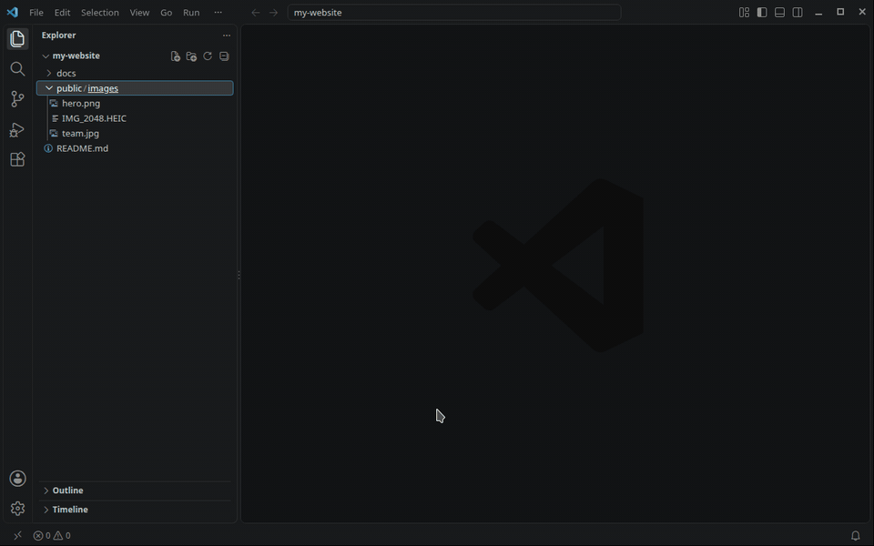

<p align="center">
  <a href="https://converter.studio"></a>
</p>

# Converter Studio for VS Code

Convert files without leaving the editor. Right-click one or more files in the Explorer, choose
**Convert with Converter Studio…**, pick a format, and the result is saved next to the original.
The conversion itself runs at [Converter Studio](https://converter.studio), an online file
converter, with your account's API key.



## What it does

- **Images for the web:** JPG, PNG, GIF, TIFF and HEIC to WebP or AVIF.
- **iPhone and camera photos:** HEIC and RAW (CR2, NEF, ARW, DNG) to JPG or PNG; SVG to PNG.
- **Documents:** Word, PowerPoint, Excel, OpenDocument, Markdown and HTML to PDF.
- **Scanned PDFs to text:** text recognition (OCR) of scanned pages and photos of text.
- **Everything else Converter Studio converts:** video, audio, e-books, fonts, archives, subtitles
  and data files. The picker lists exactly the formats Converter Studio offers for the selected
  files, read from its API, so it never offers a conversion that cannot be done.
- Several files at once, with progress and a Cancel button.
- Never overwrites a file without asking: a taken name becomes `photo (1).webp`.
- Asks before a conversion that costs more credits than your limit (long videos, for example).


## Getting started

1. Make a free account at [converter.studio](https://converter.studio) and create an API key on
   your [account page](https://converter.studio/account#api-keys).
2. In VS Code, run **Converter Studio: Set API Key** from the Command Palette and paste the key.
   It is kept in VS Code's secret storage (your operating system's keychain), never in settings.
3. Right-click files in the Explorer (or an editor tab) and choose **Convert with Converter
   Studio…**. From the Command Palette, the same command converts the active file, or asks for
   files when none is open.

## Commands

| Command                                 | What it does                                                      |
| --------------------------------------- | ----------------------------------------------------------------- |
| Convert with Converter Studio…          | Converts the selected files, the active file, or files you choose |
| Converter Studio: Set API Key           | Checks a key with Converter Studio and saves it                   |
| Converter Studio: Remove API Key        | Removes the key from VS Code                                      |
| Converter Studio: Show Plan and Credits | Shows your plan and the credits left                              |

To convert the active file with one key press, bind the command with a target format (and, if
you like, [conversion options](https://converter.studio/developers)) in `keybindings.json`:

```json
{
  "key": "ctrl+alt+w",
  "command": "converterStudio.convert",
  "args": { "to": "webp" }
}
```

## Settings

| Setting                         | Default                        | What it does                                                                   |
| ------------------------------- | ------------------------------ | ------------------------------------------------------------------------------ |
| `converterStudio.maxCredits`    | `20`                           | A conversion that costs more credits than this asks first (`0`: always ask)    |
| `converterStudio.existingFiles` | `keepBoth`                     | `keepBoth` saves `photo (1).webp`; `ask` lets you overwrite, keep both or skip |
| `converterStudio.apiUrl`        | `https://converter.studio/api` | Only for a test server; user settings only, never a workspace's                |

## Credits and limits

Each conversion uses credits of your Converter Studio account: most image and document
conversions cost 1 credit, video and audio cost more depending on their length. A free account
gets free credits every day; [paid plans](https://converter.studio/pricing) have more credits and
larger file sizes. A failed conversion costs nothing.

Cancel stops the extension at once. A conversion that has already started at Converter Studio
may still finish there and use its credits; nothing is saved in your project.

## Privacy

The files you convert are uploaded to Converter Studio over HTTPS, converted, and deleted: the
upload right after the conversion, the result after 6 hours. The extension sends your API key only
to the API address in its settings, never in a log, and it collects no telemetry. Its requests
name the extension and its version (`X-Converter-Studio-Client`) so Converter Studio can count
conversions by integration. See the [privacy policy](https://converter.studio/privacy).

## Requirements

VS Code 1.90 or later, on a desktop (not VS Code for the Web). In a remote window (SSH, WSL, a
container) the extension runs next to the files, so that machine needs to reach converter.studio.

## Support

Questions and bug reports: [GitHub issues](https://github.com/tariksucu/vscode-converter-studio/issues)
or support@converter.studio. The API is documented at
[converter.studio/developers](https://converter.studio/developers).

## License

[MIT](LICENSE), © Converter Studio.
