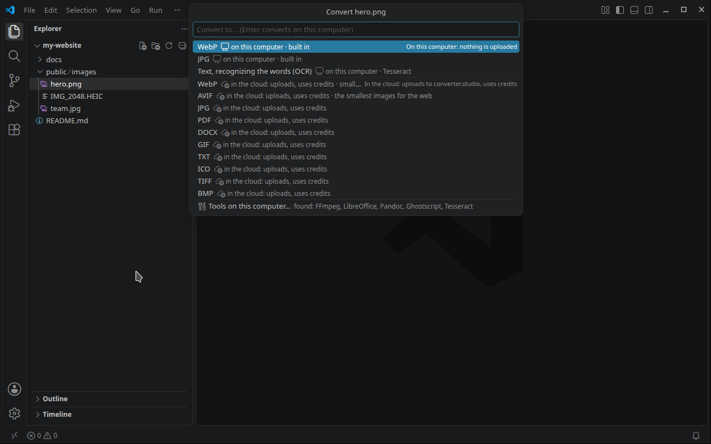

<p align="center">
  <a href="https://converter.studio"></a>
</p>

# Converter Studio for VS Code

A file converter in the Explorer that works on your computer first. Right-click one or more files,
choose **Convert with Converter Studio…**, pick a format, and the result is saved next to the
original. Every format in the picker says where it runs:

1. **On this computer**, the default: the extension's own conversions and the tools you already
   have (FFmpeg, LibreOffice, Pandoc, ImageMagick, Ghostscript, Tesseract). Nothing is uploaded.
2. **Converter Studio for desktop**, when you turn it on: the files are handed to the desktop app,
   and you press Convert there.
3. **In the cloud** at [Converter Studio](https://converter.studio), only when you choose it: the
   file is uploaded and the conversion uses credits of your account.

A conversion that fails on this computer is never sent to the cloud by itself; the message offers
**Try in the Cloud (uses credits)**, and nothing happens unless you click it.




## On this computer

**Built in**, with no tool installed:

- JSON to CSV or YAML, and CSV to JSON. Nothing is dropped or changed: every column keeps a name
  of its own (`id`, `id_2`; an empty header cell becomes `column2`), and numbers keep their digits
  (9007199254740993 stays exact).
- PNG, JPG, WebP, GIF, BMP, AVIF, ICO and SVG to PNG, JPG or WebP, with the editor's own image
  decoder and encoder. A tab "Converter Studio: converting images" is open while it works.

**With the tools you have installed** (each one adds its formats to the picker):

| Tool                   | What it converts                                                                                                               |
| ---------------------- | ------------------------------------------------------------------------------------------------------------------------------ |
| FFmpeg                 | Video to MP4, WebM, MOV, MKV, AVI or GIF; video or audio to MP3, WAV, M4A, AAC, FLAC, OGG or Opus; GIF to MP4 or WebM          |
| LibreOffice            | Word, ODT and RTF to each other, PDF or text; Excel, ODS and CSV to each other or PDF; PowerPoint and ODP to each other or PDF |
| Pandoc                 | Markdown, HTML, DOCX, ODT and EPUB to Markdown, HTML, DOCX, ODT, EPUB, RTF or plain text                                       |
| Pandoc and LibreOffice | Markdown to PDF: Pandoc writes a Word file, LibreOffice makes the PDF of it (no LaTeX needed)                                  |
| ImageMagick            | Images, also to TIFF, AVIF, GIF, BMP and ICO; HEIC photos and camera RAW when your ImageMagick reads them                      |
| Ghostscript            | A smaller PDF; the text of a PDF                                                                                               |
| Tesseract              | The words in an image (OCR); with Ghostscript, the words of a scanned PDF                                                      |

The extension finds them on your PATH and in their usual install folders (Homebrew,
`LibreOffice.app`, Program Files, winget, Chocolatey, Scoop). **Converter Studio: Show Tools on
This Computer** lists what it found, what each one adds and where to get the others; for a tool
installed somewhere else, set its path in `converterStudio.local.toolPaths`. It checks what each
tool can do instead of assuming: HEIC is offered only when your ImageMagick reads HEIC, MP3 only
when your FFmpeg has its encoder.

How the tools are run: as a program with a list of arguments, never through a shell; with a time
limit (`converterStudio.local.timeoutMinutes`); **Cancel** stops the tool and the programs it
started. A tool writes into a temporary folder of its own; the result is then saved next to the
original under a free name (`photo (1).webp`), and the original is never changed. LibreOffice runs
with a profile of its own, so an open LibreOffice window is not disturbed.

In a remote window (SSH, WSL, a container), "this computer" is the machine the files are on, and
the tools installed there are used.

## Workspace trust

In [Restricted Mode](https://code.visualstudio.com/docs/editor/workspace-trust) (a workspace you
have not trusted), the extension runs **no tool**, not even to ask for its version. Converting
means running a program on the workspace's files, and a crafted file is the usual way to attack a
converter, so a project you have not trusted does not get to make your computer run FFmpeg,
LibreOffice or Ghostscript on its files. The picker says so and offers to manage trust. The
built-in conversions (which read data and decode images in the editor's sandbox), the desktop app
and the cloud still work there.

A workspace can never choose which program runs: tool paths are read from user settings only, and
PATH folders inside the workspace are skipped.

## Converter Studio for desktop

Turn on **Use the Converter Studio desktop app when installed**
(`converterStudio.desktopApp.enabled`) and the picker gets a section for
[Converter Studio for desktop](https://converter.studio/download). Choosing one of its formats
hands the files to the app with a `converter-studio://convert` link: the app shows "Files from
Visual Studio Code" with Continue or Ignore, then the files with the format chosen, and you press
Convert there. Nothing converts by itself. It needs **Converter Studio for desktop 0.1.11 or
later**; an older version only comes to the front. It takes up to 200 files (50 GB) at a time.

The desktop app reads files from your disk, so the hand-off is not offered in a remote window or
for files of a virtual file system. The Snap and Flatpak builds of the desktop app can only read
files in your home folder.

## In the cloud

For what this computer cannot do (HEIC without ImageMagick, PDF to Word, e-books, fonts…), the
picker lists every format Converter Studio offers under **In the cloud: uploads to
converter.studio, uses credits**.

1. Make a free account at [converter.studio](https://converter.studio) and create an API key on
   your [account page](https://converter.studio/account#api-keys).
2. Run **Converter Studio: Set API Key (for the cloud)** and paste the key. It is kept in VS Code's
   secret storage (your operating system's keychain), never in settings.

Most image and document conversions cost 1 credit; video and audio cost more depending on their
length. A free account gets free credits every day; [paid plans](https://converter.studio/pricing)
have more. A conversion that costs more than `converterStudio.maxCredits` asks first, and a failed
one costs nothing. Cancel stops the extension at once; a conversion already started at Converter
Studio may still finish there and use its credits.

## Commands

| Command                                       | What it does                                                            |
| --------------------------------------------- | ----------------------------------------------------------------------- |
| Convert with Converter Studio…                | Converts the selected files, the active file, or files you choose       |
| Converter Studio: Show Tools on This Computer | The tools found, what each adds, the desktop app and the cloud settings |
| Converter Studio: Set API Key (for the cloud) | Checks a key with Converter Studio and saves it                         |
| Converter Studio: Remove API Key              | Removes the key from VS Code                                            |
| Converter Studio: Show Plan and Credits       | Shows your plan and the credits left                                    |

To convert the active file with one key press, bind the command with a target format in
`keybindings.json`. It converts on this computer; add `"where": "cloud"` or `"where": "desktop"`
for the others, and [conversion options](https://converter.studio/developers) such as
`{ "ocr": true }` with `"options"`:

```json
{
  "key": "ctrl+alt+w",
  "command": "converterStudio.convert",
  "args": { "to": "webp" }
}
```

## Settings

| Setting                                | Default                        | What it does                                                                       |
| -------------------------------------- | ------------------------------ | ---------------------------------------------------------------------------------- |
| `converterStudio.desktopApp.enabled`   | `false`                        | Offers Converter Studio for desktop in the picker                                  |
| `converterStudio.cloud.enabled`        | `true`                         | Offers the cloud in the picker; off, the extension never contacts converter.studio |
| `converterStudio.local.toolPaths`      | `{}`                           | Paths of tools installed where the extension does not look (user settings only)    |
| `converterStudio.local.timeoutMinutes` | `30`                           | A conversion on this computer that takes longer is stopped                         |
| `converterStudio.local.ocrLanguages`   | `eng`                          | Tesseract's languages, joined by `+` (`eng+deu`)                                   |
| `converterStudio.existingFiles`        | `keepBoth`                     | `keepBoth` saves `photo (1).webp`; `ask` lets you overwrite, keep both or skip     |
| `converterStudio.maxCredits`           | `20`                           | In the cloud, a conversion that costs more asks first (`0`: always ask)            |
| `converterStudio.apiUrl`               | `https://converter.studio/api` | Only for a test server; user settings only, never a workspace's                    |

## Privacy

- **On this computer**, the files stay where they are: the extension and the tools read them on
  your disk and write the result next to them. One exception comes from Pandoc itself: when it
  builds a DOCX, ODT or EPUB, it downloads the images a document links to by web address.
- **The desktop app** gets a link with the files' paths; the extension uploads nothing.
- **In the cloud**, only the files you choose to convert there are uploaded to Converter Studio
  over HTTPS, converted, and deleted: the upload right after the conversion, the result after 6
  hours. Your API key goes only to the API address in the settings, never into a log.
- To list the cloud's formats, the picker reads Converter Studio's public format list (no file, no
  key). Turn off `converterStudio.cloud.enabled` and the extension never contacts converter.studio.
- No telemetry. Requests to the API name the extension and its version
  (`X-Converter-Studio-Client`) so Converter Studio can count conversions by integration. See the
  [privacy policy](https://converter.studio/privacy).

## Requirements

VS Code 1.90 or later on a desktop (not VS Code for the Web), or an editor that installs
extensions from Open VSX, such as VSCodium, Cursor or Windsurf. For conversions beyond the built-in
ones, the tools above; the cloud needs a Converter Studio account.

## Support

Questions and bug reports: [GitHub issues](https://github.com/tariksucu/vscode-converter-studio/issues)
or support@converter.studio. The API is documented at
[converter.studio/developers](https://converter.studio/developers).

## License

[MIT](LICENSE), © Converter Studio.
